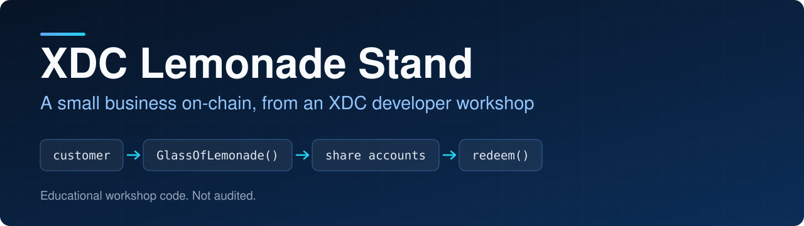
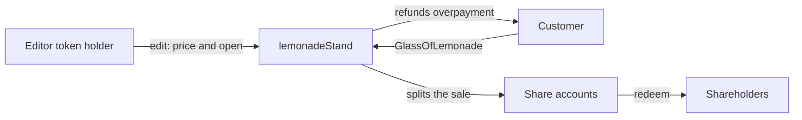

<p align="center">
  
</p>

<p align="center">
  
<a href="https://github.com/CoinClubQuincy/XDC-LemonadeStand/actions/workflows/build.yml"></a>        
</p>

<p align="center">
  <a href="#how-it-works">How it works</a> · <a href="#try-it">Try it</a> · <a href="#what-is-tested">What is tested</a>
</p>

Customers buy lemonade from a contract, and every sale is split among the stand's shareholders. It's the smallest complete example of the [XRC-SHARES](https://github.com/CoinClubQuincy/XRC-SHARES) pattern, made for a developer workshop.

> [!NOTE]
> This is teaching code. It has not been audited and is not meant for production. It carries the same `SHARE.sol` limits listed in [XRC-SHARES](https://github.com/CoinClubQuincy/XRC-SHARES#known-issues).

## How it works



| File | Role |
| --- | --- |
| [`SHARE.sol`](SHARE.sol) | Mints up to 1,000 shares and credits each share's account when money arrives |
| [`LemonadeStand.sol`](LemonadeStand.sol) | Adds 3 editor tokens, a price, an open or closed state and a sales counter |

| Function | Who | What it does |
| --- | --- | --- |
| `edit(description, price, open)` | Editor token holder | Sets the description and price, and opens or closes the stand |
| `GlassOfLemonade(amount)` | Anyone | Buys glasses while the stand is open, and refunds any overpayment |
| `viewAccount(token)` | Anyone | Shows what a share has earned |
| `redeem()` | Shareholder | Withdraws what the caller's shares have earned |

## Try it

The quickest way is [Remix](https://remix.ethereum.org):

1. Add both `.sol` files and compile with Solidity `^0.8.10`.
2. Deploy `lemonadeStand` with a name, description, symbol, share count and metadata URI.
3. Call `edit` to set a price and open the stand.
4. Buy a glass with `GlassOfLemonade`, sending the price as the value.
5. Call `redeem` from a shareholder account.

To run the tests instead:

```bash
git clone https://github.com/CoinClubQuincy/XDC-LemonadeStand.git
cd XDC-LemonadeStand
git clone --depth 1 -b v4.9.6 https://github.com/OpenZeppelin/openzeppelin-contracts lib/openzeppelin-contracts
git clone --depth 1 -b v1.9.7 https://github.com/foundry-rs/forge-std lib/forge-std
forge test
```

You need [Foundry](https://getfoundry.sh). Tests named `test_KnownIssue_*` pass because they pin a defect, so a passing run does not mean the defect is gone.

## What is tested

[`test/foundry/LemonadeStand.t.sol`](test/foundry/LemonadeStand.t.sol) has 5 tests and runs in CI on every push. They cover the closed state, editor access, underpayment, overpayment refunds, and a sale being split and redeemed. It has not been run on a real network or audited.

<details>
<summary><strong>More XDC projects</strong></summary>

| Group | Project | What it is |
| --- | --- | --- |
| Standards | [XRC-SHARES](https://github.com/CoinClubQuincy/XRC-SHARES) | Dividend-paying NFT shares and SPLITS for a DApp |
| Standards | [XRCDividendPlus](https://github.com/CoinClubQuincy/XRCDividendPlus) | Dividend-paying XRC-20 token |
| Treasury and finance | [Multi-Sig-Treasury](https://github.com/CoinClubQuincy/Multi-Sig-Treasury) | Treasury controlled by tokenized keys |
| Treasury and finance | [XRC-Airdrop](https://github.com/CoinClubQuincy/XRC-Airdrop) | Self-run token airdrop |
| Treasury and finance | [XRC-Credit](https://github.com/CoinClubQuincy/XRC-Credit) | Debt contract skeleton |
| Treasury and finance | [XDC-Defi-Instruments](https://github.com/CoinClubQuincy/XDC-Defi-Instruments) | Assets, agreements, forwards, futures and a marketplace |
| Identity and access | [LoginMFAContract](https://github.com/CoinClubQuincy/LoginMFAContract) | Login with a password and an NFT |
| Identity and access | [PrivateAccessToken](https://github.com/CoinClubQuincy/PrivateAccessToken) | Token-gated contract data demo |
| Identity and access | [Delegated_Authority](https://github.com/CoinClubQuincy/Delegated_Authority) | KYC notary proof of concept |
| Learning and libraries | [Non-Financial-SmartContracts](https://github.com/CoinClubQuincy/Non-Financial-SmartContracts) | Games, inventory, keys and on-chain repositories |
| Tools | [XDC_Python_SDK_V1](https://github.com/CoinClubQuincy/XDC_Python_SDK_V1) | Python client for the XDC JSON-RPC API |
| Tools | [PrivateXDCNode_SetupScript](https://github.com/CoinClubQuincy/PrivateXDCNode_SetupScript) | Private XDC network setup scripts |
| Tools | [WebApp_to_XDCPay](https://github.com/CoinClubQuincy/WebApp_to_XDCPay) | Web app to XDCPay tutorial |
| Multi-chain | [CoinClub_Framework](https://github.com/CoinClubQuincy/CoinClub_Framework) | Python library with an XDC adapter |
| Interfaces | [Contract_Interface_Model_Language](https://github.com/CoinClubQuincy/Contract_Interface_Model_Language) | Interface documents for smart contracts and APIs |

</details>

## License

MIT, as declared in the SPDX headers of the source files. This repository has no separate license file.
